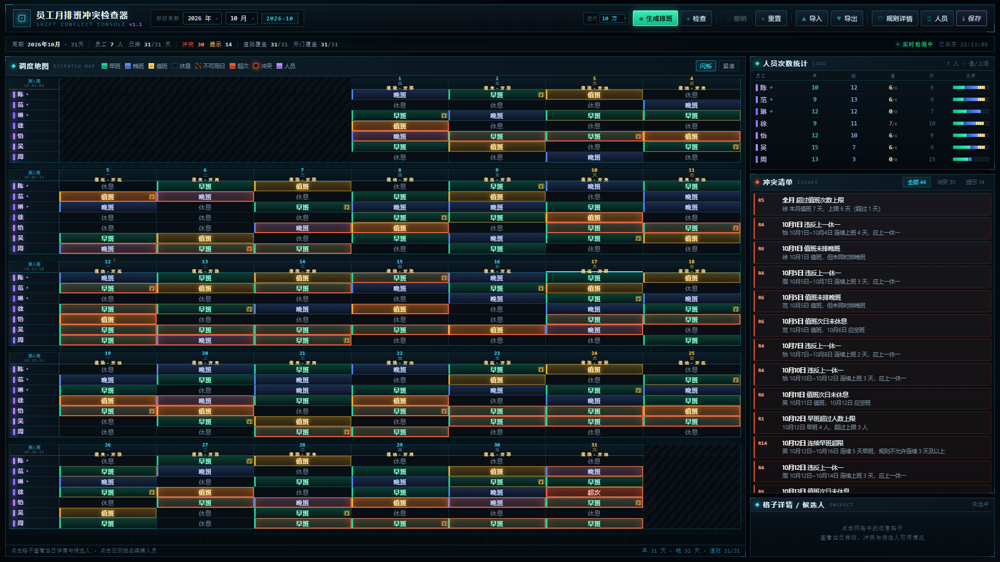

# 员工月排班冲突检查器 · Shift Conflict Console

> 📘 **开发/交接请先看 [DEV.md](DEV.md)**：目录结构、数据模型、20 条规则、生成算法、API、打包发布与踩坑记录。

一个 **Flask + HTML** 的月排班检查与生成工具：把十条排班规则量化成可执行的约束，
在「控制台排班地图」上逐格检查冲突、定位问题、展示候选人，并能按规则自动生成
冲突最少的月度排班表。

界面风格：深黑背景 / 冰蓝网格 / 白色文字；格子配色为 **早班青绿 · 晚班靛蓝 · 值班琥珀金 · 休息深灰 · 冲突橙红**，
左边缘还有一条状态色条，小屏也能一眼分辨班次。

---

## 在线更新（exe 版）

顶栏 **「更新」** 会读取 GitHub 上最新的 Release：

* 有新版本 → 显示版本号、包大小、更新说明；点「立即更新」开始下载，界面实时显示
  进度条、已下载/总大小、以及 3 秒滑动窗口的**下载速度**；
* 下载完成 → 「立即安装并重启」：程序会把安装包解压到 `data/update/staging`，
  写一个 `apply_update.bat`，退出后由脚本用 robocopy **覆盖程序文件**并重新启动；
* **只替换程序文件，`config/` 与 `data/` 原样保留**；重启时沿用原来的命令行参数
  （`--port`、`--no-browser` 等）。

仓库是公开的，所以不需要任何 token。若改回私有仓库，在 `config/settings.json` 里加：

```json
"update": { "repo": "XxToradoxX/shift-checker", "asset": "ShiftChecker.zip", "token": "<GitHub Token>" }
```

更新日志写在 `data/update/apply.log`，出问题时先看它。

## 打包成免安装 exe（给没有 Python 的电脑用）

```bash
pip install pyinstaller
python -m PyInstaller --noconfirm --clean --onedir --console --name ShiftChecker \
  --paths . --paths vendor \
  --add-data "templates;templates" --add-data "static;static" \
  --distpath dist --workpath build app.py
```

产物在 `dist/ShiftChecker/`（约 74 MB）：

* 整个文件夹拷到目标电脑，双击 `ShiftChecker.exe` 即可，**不需要装 Python**；
* 启动后会自动打开浏览器（`--no-browser` 可关闭），地址 http://127.0.0.1:8765/ ；
* `config/` 与 `data/` 会**在 exe 同级目录自动创建**，所以：
  * 把 U 盘里一份整个文件夹拷走就能换机器继续用；
  * 想沿用现有数据，把本项目的 `config/`、`data/` 复制到 exe 旁边即可；
* 单文件（`--onefile`）也能打，但每次启动要多解压一次、多核子进程启动更慢，推荐用 onedir 文件夹版。

> 未签名 exe 首次运行可能被 SmartScreen 拦：点「更多信息 → 仍要运行」；部分安全软件会误报 PyInstaller 程序，加信任即可。

## 快速开始

```bash
pip install -r requirements.txt
python app.py
```

也可以直接双击 **`start.bat`**（自动切到脚本目录、检查 Python、启动后再暂停）。

启动后自动打开浏览器，默认地址 <http://127.0.0.1:8765/>。控制台会打印：

```
  员工月排班冲突检查器
  配置目录：...\config
  数据目录：...\data
  访问地址：http://127.0.0.1:8765/
  多核并行：可用（12 核）        ← 不可用时这里会写明原因，生成自动退回单进程
```

* **程序里不再内置任何员工或示例排班**，所有数据都来自 `config/` 与 `data/`。
  * 首次运行会创建空目录；打开页面后先在「人员」里新增员工（可用日、值班上限、关键岗等），
    再手动排班或点「生成排班」。
  * 想沿用已有数据：把备份的 `config/employees.json` 与 `data/schedules/*.json` 放回对应目录即可。
* 前端（Vue 3 + Vite）的构建产物已放在 `static/dist/`，直接运行即可。
* 常用参数：`python app.py --port 9000 --no-browser`
* 若环境里没有 Flask，程序会尝试使用项目自带 `vendor/` 目录中的依赖副本。

### 修改前端后重新构建

```bash
cd frontend
npm install        # 首次
npm run build      # 产物输出到 ../static/dist
```

开发模式（热更新，`/api` 已代理到 8765）：

```bash
cd frontend
npm run dev        # 打开 http://127.0.0.1:5173
```

---

## 功能一览

| 模块 | 说明 |
| --- | --- |
| 调度地图 | 按「周一到周日」分行的周网格，人员 × 日期，一格一状态；月首不足一周的格子留空且不可编辑；冲突格红色标记、悬停缩放、选中高亮 |
| 人员次数统计 | 每人 早/晚/值/休 次数、值班目标进度条，超限标红 |
| 冲突清单 | 按「冲突 / 提示」筛选，点击任意条目定位到对应格子并展示候选人可用情况 |
| 格子详情 | 选中格子后可直接改早班/晚班/值班/全天/空班/不可用日；候选人一键添加或移出；开门人点姓名即可切换 |
| 规则详情 | 13 条基础规则的可视化（含量化公式）、启停、严重级别与参数调整；月度特殊规则增删改 |
| 人员管理 | 增删改员工、**上下移动调整行顺序**、可用日矩阵、值班目标/上限、**全月休息天数**、**偏好班次**、关键岗、上一休一、早晚轮换 |
| 自动生成 | 带回溯 + 模拟退火，尽量满足全部硬性规则；做不到时输出冲突最少的一版并说明 |
| 撤销 / 重置 | 60 步撤销；重置可清空或恢复初始导入 |
| 导入导出 | 导出 CSV（长表布局，Excel 可直接打开）；导入 CSV / Excel（自动识别两种布局） |
| 按月存档 | 每个月份一份 JSON（`data/schedules/YYYY-MM.json`），可任意切换年份月份 |

---

## 规则量化（基础规则）

| 编号 | 规则 | 量化表达 |
| --- | --- | --- |
| R1 | 早晚班人数 2~3 人，优先 2 人 | `min ≤ \|早(d)\|, \|晚(d)\| ≤ max`，超过 prefer 记提示 |
| R2 | 一人不能同一天上早晚两班 | `早(d) ∩ 晚(d) = ∅`（上一休一员工除外，他们当天早晚都上） |
| R3 | 每天必须值班 | `min ≤ \|值(d)\| ≤ max`（默认 1） |
| R4 | 周、怡上一休一 | 上班日：`早(e,d) ∧ 晚(e,d)` 同时成立；`work(d) ≠ work(d+1)` |
| R5 | 陈/范/徐/吴/怡 每月值班 6 天 | `target-tol ≤ dutyCount(e) ≤ cap`，超 cap 记「超过次数上限」 |
| R6 | 值班当天排晚班，次日空班 | `e∈值(d) ⇒ e∈晚(d)` 且 `work(e,d+1)=false` |
| R7 | 早晚班各须有陈/范/琳之一 | `早(d)∩关键 ≠ ∅ ∧ 晚(d)∩关键 ≠ ∅` |
| R8 | 徐一天早一天晚，服从值班 | 连续出勤且都非值班时 `shift(d) ≠ shift(d+1)` |
| R9 | 怡晚班+值班时早班排吴 | `怡∈晚(d) ∧ 怡∈值(d) ⇒ 吴∈早(d)` |
| R10 | 休息天数配额（琳约 6 天/月） | `\|rest(e) − monthlyRest(e)\| ≤ tolerance`，目标在员工属性里配置 |
| R11 | 不可用日不得排班 | `d ∉ avail(e) ⇒ work(e,d)=false` |
| R12 | 开门人：1 人/天、须在早班、不连开 | `opener(d)∈早(d)`，`opener(d) ≠ opener(d-1)` |
| R13 | 连续上班上限（默认关闭） | `maxRun(e) ≤ maxConsecutive` |
| R14 | 连续早班限制 | `run(早,e) ≥ 3 → 冲突；≥ 2 → 提示`（阈值可调） |
| R15 | 避免连续晚班（默认关闭） | `run(晚,e) ≥ maxConsecutive` 记提示 |
| R16 | 班次数上下限 | `minEarly(e) ≤ |早(e)| ≤ maxEarly(e)`，晚班同理（含值班日） |
| R17 | 值班间隔均衡（建议） | 相邻两次值班 `d2 − d1 ≥ minGap`（默认 3 天） |
| R18 | 开门人分配均衡（建议） | `|open(e) − 平均开门次数| ≤ tolerance` |
| R19 | 仅在单号工作 | `oddOnly(e) ⇒ 双数日不得排班` |
| R20 | 仅在双号工作 | `evenOnly(e) ⇒ 单数日不得排班` |

> **每条规则都可编辑「处理建议」**：规则详情里那段文字会显示在冲突清单/格子详情中，可改成你自己的处理方式。
>
> **冲突定位按规则类型高亮**：点冲突清单里的条目，地图上会**高亮**该规则涉及的全部格子（其余变暗），
> 再点同一条目即可取消、恢复原本视图。例如 R7 高亮当天所有关键岗、R5 高亮该员工全月所有值班日、
> R14 高亮连续早班那一段。所有提示都是静态高亮，不做闪烁动画。

> **停用规则 = 检查不报 + 生成不强制**：每条规则的「启用」开关同时作用于检查器和生成器，
> 关掉「关键岗」后生成时真的不再保证早晚各有一名关键岗，关掉「班次人数」后就会出现 1 人或 5 人一班。
> 例外：不可用日（规则 11）属于排班数据本身，生成时始终遵守。

> **约束优先级**：每条规则都有一个 0.01~2.00 的优先级（默认 1.00，步进 0.01），它会乘到生成器里该规则的软约束权重上——
> 调到 2.00 表示「尽量满足它」，调到 0.01 表示「几乎可以让步」。硬性规则（人数、关键岗、值班上限等）不受优先级影响。

> 规则 1~10 即业务给出的十条基本规则；R11/R12 来自补充说明（不可用日、开门人轮换），
> 规则 1~10 即业务给出的十条基本规则；R11/R12 来自补充说明（不可用日、开门人轮换），
> R13/R15 为可选增强项（连续上班、连续晚班）；**R14 连续早班**默认「2 天提示、3 天判冲突」，
> 阈值可在规则详情里调；**R16** 按员工属性里的早/晚班次数上下限校验。
> 所有规则都可单独启停、调整参数或调整严重级别。

### 员工属性中的排班参数

| 字段 | 作用 |
| --- | --- |
| 值班目标 / 值班上限 | 每人每月值班天数（规则 5），超过上限记「超过次数上限」 |
| 全月休息 | 该员工当月应休息天数（规则 10），留空表示不限制 |
| 早班最少/最多、晚班最少/最多 | 当月班次数上下限（规则 16），留空表示不限制；晚班包含值班日 |
| 偏好班次 | 生成时倾斜早班或晚班（如周设为「多排早班」） |
| 单号工作 / 双号工作 | 只允许在单数日（1、3、5…）或双数日（2、4、6…）上班；两者互斥（规则 19/20） |
| 关键岗 / 上一休一 / 早晚轮换 | 对应规则 7 / 4 / 8 |

### 月度特殊规则（可选类型）

指定某人某天：休息 / 早班 / 晚班 / 值班 / 不可用 / 不值班 / 开门人；指定某天某班人数；
指定某人本月值班次数；指定某人某日期区间休息；两人不得同班 / 必须同班。均可增删改并附备注。

---

## 生成算法

1. **值班求解**：回溯搜索，逐日选人，前向剪枝（配额、值班次日空班、上一休一相位、特殊规则）。
2. **铺班次**：值班人进晚班，早/晚各补到 2 人，保证关键岗覆盖、怡值班补吴、徐早晚轮换、
   琳按周休 4 天。
3. **模拟退火**：以与检查器同逻辑的加权代价函数做局部搜索（换班、挪休息日、换值班日、改开门人）。
> 顶栏「迭代」控制退火迭代次数（6 万 / 10 万 / 20 万 / 50 万 / 100 万）：次数越多越接近最优、耗时越久。
> 10 万次约 10 秒、100 万次约 90 秒；勾选多核时会把总次数平均分给 4 个进程并行跑，取冲突最少的一版
> （单核约 22 秒/10 万次；受限沙箱下无法开子进程会自动退回单进程并在生成说明里提示）。

4. 若硬约束无法全部满足（例如 31 天的月份里 5 人 × 6 天 = 30 人次，必然多出 1 天值班），
   输出**冲突最少**的方案，并在提示里列出需要人工确认的条目。

---

## 目录结构

```
app.py                  Flask 入口与 REST API
scheduler/
  model.py              数据模型、按月存档、初始数据播种
  rules.py              规则目录、量化定义、检查引擎
  generator.py          值班回溯 + 铺班 + 模拟退火
  csvio.py              CSV / Excel 导入导出
frontend/               Vue 3 + Vite 前端源码
  src/
    App.vue             整体布局与快捷键
    store.js            全局状态 + 所有 API 动作
    style.css           控制台主题样式
    components/         TopBar / StatusStrip / MapPanel / StatsPanel
                        ConflictList / Inspector / RulesModal
                        PeopleModal / ConfirmModal / Toasts
config/
  employees.json        员工与岗位属性（含顺序）
  settings.json         程序设置
data/
  schedules/YYYY-MM.json 每月排班、可用日、特殊规则、规则覆盖
  exports/              导出目录
static/dist/            前端构建产物（app.js / app.css）
templates/              Flask 模板（index.html / need_build.html）
vendor/                 离线依赖副本（可选）
```

用 `Ctrl+Z` 撤销，`Esc` 关闭弹窗/取消高亮，方向键可在地图上移动选择。

---

## 说明与限制

* 「开门人」：原表用蓝色标记开门人，但该颜色信息未保存在 xlsx 内，初始数据按轮换规则自动指派，
  后续可在格子里手动改（特殊规则里也能锁定某人某天开门）。
* 排班的「空班/休息」不需要手工填写，除早/晚/值以外的员工自动视为空班。
* 上一休一员工（周、怡）上班那天早班和晚班都会出现，格子上显示为「全天」（青蓝双色）。
* 本项目按单机本地使用设计（Flask 自带服务器），不要直接暴露到公网。

---

## 界面预览



* `docs/preview-map.png` 周视图排班地图：周一到周日一行，月初不足一周的格子留空不可编辑；表头显示「值/开」，人数异常的日子标红点
* `docs/preview-inspect.png` 点击冲突后定位到格子，并展示当日排班与候选人可用情况
* `docs/preview-generated.png` 自动生成后的排班（冲突 1、提示 0）
* `docs/preview-people.png` 人员管理：▲▼ 调整行顺序、可用日、值班目标/上限
* `docs/preview-rules.png` 规则详情：量化公式、参数、月度特殊规则